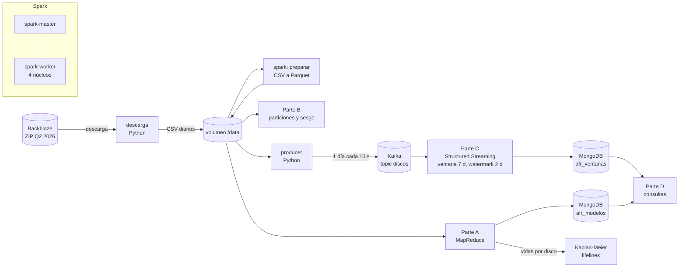

# ¿Cuánto viven los discos? — MapReduce, balanceo de carga y Spark Streaming

Ejercicio de Big Data (IUE) sobre los datos de vida útil de discos duros de **Backblaze Drive Stats**: cuánto viven los discos según su modelo, medido con la **tasa de falla anualizada (AFR)** y con curvas de supervivencia de **Kaplan-Meier**.

**Integrantes:** Santiago Arcila Gutiérrez, Alejandro Restrepo Uribe, Natalia Florez Pérez
**Docente:** Andrés Felipe Hernández Marulanda

```
AFR (%) = fallas ÷ (días-disco ÷ 365) × 100
```

Cada fila del dataset es un disco activo en un día, así que **una fila = un día-disco**. Con las cifras de Backblaze para Q2 2026 (1.498 fallas en 31.553.350 días-disco) la fórmula da 1,73 %, el valor que publica Backblaze; la Parte A lo comprueba.

## Arquitectura



| Servicio | Qué hace |
|---|---|
| `spark-master`, `spark-worker` | Clúster Spark 3.5.3 standalone (UI en http://localhost:8090) |
| `spark` | Lanza los trabajos: `docker compose run --rm spark <trabajo>` |
| `kafka` | Kafka 3.8 en modo KRaft (sin ZooKeeper) |
| `mongo` | MongoDB 7 (Compass: `mongodb://localhost:27019`) |
| `descarga`, `producer`, `python` | Imagen Python: descarga, producer de Kafka, Parte D, Kaplan-Meier y gráficos |

Los resultados (CSV, JSON y PNG) quedan en la carpeta `resultados/` del repositorio.

## Cómo ejecutarlo

Requisitos: Docker Desktop con unos 6 GB de RAM, unos 15 GB libres en disco e internet para bajar el ZIP de 2,1 GB. Si el proyecto anterior está prendido, conviene detenerlo para liberar memoria.

```powershell
# 0. Construir las imágenes (la primera vez, 5 a 10 minutos)
docker compose --profile trabajos build

# 1. Descargar los datos: baja el ZIP de Q2 2026 y extrae 14 días (DIAS=7 para menos)
docker compose run --rm descarga

# 2. Prender los servicios
docker compose up -d spark-master spark-worker kafka mongo

# 3. Preparar: CSV (≈190 columnas) a Parquet (6 columnas)
docker compose run --rm spark preparar

# 4. Parte A: MapReduce
docker compose run --rm spark parte_a

# 5. Parte B: particiones y sesgo (unos minutos)
docker compose run --rm spark parte_b

# 6. Parte C: en una ventana de PowerShell, el streaming...
docker compose run --rm spark parte_c
#    ...y en otra ventana, el producer
docker compose run --rm producer

# 7. Parte D: consultas en MongoDB
docker compose run --rm python python parte_d.py

# 8. Reto: Kaplan-Meier, y los gráficos
docker compose run --rm python python km.py
docker compose run --rm python python graficos.py
```

El streaming se detiene solo cuando lleva 60 segundos sin recibir datos, y al final compara su resultado contra un cálculo por lotes.

## Datos

- **Fuente:** [Backblaze Drive Stats](https://www.backblaze.com/drivestats), trimestre Q2 2026 (`data_Q2_2026.zip`). Los datos son gratuitos citando a Backblaze y no se pueden vender.
- **Muestra:** los primeros 14 días del trimestre (unas 350 mil filas por día). Se cambia con `DIAS` y `DESDE`.
- **Columnas usadas:** `date`, `serial_number`, `model`, `capacity_bytes`, `failure` y `smart_9_raw` (horas encendido, usada como edad del disco). `descargar.py` revisa el encabezado del primer CSV y lo deja en `resultados/00_esquema_y_muestra.json`, porque el esquema cambia entre trimestres.
- Un disco que falla aparece con `failure = 1` su último día y luego deja de aparecer.

## Parte A: MapReduce

`spark/jobs/parte_a.py`

1. **Map:** cada fila emite `(modelo, (1, falla))`. **Reduce:** `reduceByKey` suma `(días-disco, fallas)` por modelo.
2. El mismo cálculo con `groupBy("model").agg(count, sum)` de DataFrames. El trabajo compara modelo a modelo e imprime `¿Coinciden RDD y DataFrame? SÍ`.
3. AFR por modelo y total. Se marcan como *no confiables* los modelos con menos de 10.000 días-disco (`MIN_DIAS_DISCO`): con pocos días-disco, una sola falla cambia mucho la tasa.
4. **Censura:** días observados por serial (`resultados/parte_a_censura.csv`). En una ventana de 14 días casi todos los discos siguen vivos al final: de ellos solo se sabe que *aún no han fallado* (censura por la derecha). Esa tabla por disco (`/data/parquet/vidas`) es la entrada de Kaplan-Meier.

Salidas: `parte_a_afr_por_modelo.csv`, `parte_a_censura.csv`, `parte_a_resumen.json` y la colección `discos.afr_modelos`.

## Parte B: Balanceo de carga

`spark/jobs/parte_b.py`

- **Tiempos:** el MapReduce de la Parte A con 2, 8, 32 y 200 particiones, 3 repeticiones cada uno. El reparto (`repartition(n)` + `cache`) se hace antes y no se cronometra. Con 4 núcleos se espera que 2 particiones dejen núcleos ociosos, que 8 a 32 estén cerca del mínimo y que con 200 el costo de planificar tareas diminutas vuelva a subir el tiempo. → `parte_b_tiempos.csv`
- **Sesgo:** se reparte por modelo (`repartition(8, "model")`) y sin clave (`repartition(8)`) y se cuentan las filas por partición con `spark_partition_id()`. → `parte_b_filas_por_particion.csv`, `parte_b_modelos_top.csv`

Por qué hay sesgo: al repartir por clave, todas las filas de un modelo van a la misma partición. Si unos pocos modelos concentran gran parte de los registros (el trabajo imprime cuánto pesan los 1, 3, 5 y 10 modelos más grandes), sus particiones quedan mucho más cargadas que las demás, y esa tarea marca el tiempo de la etapa. Sin clave, Spark reparte en turnos y las particiones quedan iguales.

## Parte C: Streaming con Kafka

`python/producer.py` y `spark/jobs/parte_c.py`

- **Producer:** publica en el topic `discos` un día de datos cada 10 segundos (`SEGUNDOS_POR_DIA`). Para que Python aguante, filtra los 5 modelos con más discos (`NUM_MODELOS` o `MODELOS="m1,m2"`). `MUESTRA_PCT` toma un porcentaje de discos, elegido por serial para que sean los mismos todos los días.
- **Structured Streaming:** lee Kafka, usa la fecha como tiempo del evento y agrupa por modelo en **ventanas de 7 días con watermark de 2 días**. Calcula días-disco, fallas y AFR por ventana. Cada micro-lote se muestra en consola y se guarda en MongoDB (upsert por modelo y ventana).
- **Ventanas:** Spark alinea las ventanas de 7 días a los jueves. Con un desfase de 6 días (`VENTANA_DESFASE`) empiezan en miércoles, como el 1 de abril de 2026, y 14 días dan dos ventanas completas.
- **Watermark de punta a punta:** el watermark avanza con la fecha más alta vista menos 2 días (`resultados/parte_c_progreso.csv`). Una ventana se cierra cuando el watermark pasa su fin. Para comprobarlo, el producer manda registros **tardíos** con la fecha del primer día cuando esa ventana ya cerró (`TARDIOS=50` por día, con seriales falsos `TARDIO-…`). Spark los descarta: la columna `descartadas_por_watermark` del progreso lo muestra. Marca 1 por lote y no 50 porque Spark agrupa parcialmente antes de descartar, así que los registros de un mismo modelo y ventana cuentan como un grupo. La prueba definitiva es que la primera ventana no cambia.
- **Verificación:** al terminar, el trabajo compara cada ventana del streaming con un `groupBy` por lotes sobre el Parquet (`parte_c_verificacion.csv`). Si los tardíos hubieran entrado, no coincidiría.

## Parte D: MongoDB

`python/parte_d.py`

- `discos.afr_ventanas`: los agregados por modelo y ventana del streaming.
- `discos.afr_modelos`: el AFR por modelo de toda la muestra (Parte A).
- Consulta: los 5 modelos con mayor AFR **con un mínimo de días-disco**, comparados con el top 5 sin mínimo, que queda dominado por modelos con muy pocos discos. → `parte_d_*.csv`

Este dataset no trae ubicación, así que no hay parte geoespacial.

## Reto de investigación: Kaplan-Meier

`python/km.py` (con [lifelines](https://lifelines.readthedocs.io/))

Kaplan-Meier estima **S(t)**, la probabilidad de que un disco siga funcionando a la edad *t*. En cada edad en que ocurre una falla multiplica la supervivencia por `1 − fallas / discos en riesgo`.

- **Tiempo:** la edad del disco, a partir de las horas encendido (SMART 9 ÷ 24).
- **Evento:** el disco falló en la ventana (`fallo = 1`).
- **Censura por la derecha:** los discos que siguen vivos al final de la ventana cuentan como en riesgo hasta su última edad observada, sin sumar una falla. No se descartan ni se cuentan como fallas.
- **Truncamiento por la izquierda:** cada disco entra a la ventana ya con una edad, por ejemplo 3 años. Solo vemos discos que sobrevivieron hasta esa edad, así que solo pueden contarse en riesgo desde ahí (`entry=` en lifelines). El ajuste **ingenuo**, que los pone en riesgo desde la edad 0, infla los "en riesgo" a edades bajas y sobrestima la supervivencia. `km_ingenuo_vs_truncado.png` muestra la diferencia con los datos propios.
- A edades muy bajas hay muy pocos discos en riesgo, y una sola falla puede llevar la curva a 0. Por eso cada curva empieza en la edad desde la que hay al menos 50 discos en riesgo (`MIN_EN_RIESGO`): es la supervivencia condicionada a haber llegado a esa edad.

Salidas: `km_curvas.png`, `km_ingenuo_vs_truncado.png`, `km_resumen.csv` (S a 1, 3 y 5 años por modelo) y `km_datos.json`.

## Gráficos

`python/graficos.py` → `graf_tiempos_particiones.png`, `graf_filas_por_particion.png`, `graf_afr_modelos.png` (AFR con intervalo de confianza de Poisson del 95 %) y `graf_afr_ventanas.png`.

## Estructura

```
├── docker-compose.yml
├── spark/
│   ├── Dockerfile            Spark 3.5.3 + conectores de Kafka y MongoDB
│   └── jobs/
│       ├── submit.sh         lanza un trabajo en el clúster
│       ├── comun.py          sesión, AFR, cronómetro, guardado de CSV
│       ├── preparar.py       CSV a Parquet
│       ├── parte_a.py        MapReduce y censura
│       ├── parte_b.py        particiones y sesgo
│       └── parte_c.py        Structured Streaming (+ escritura en MongoDB)
├── python/
│   ├── Dockerfile
│   ├── descargar.py          ZIP de Backblaze -> CSV diarios
│   ├── producer.py           producer de Kafka
│   ├── parte_d.py            consultas en MongoDB
│   ├── km.py                 Kaplan-Meier
│   └── graficos.py
└── resultados/               salidas de cada parte (se suben al repositorio)
```

## Problemas frecuentes

- **El streaming no recibe nada:** el producer debe correr en otra ventana mientras `parte_c` está activo. Los dos esperan a Kafka si todavía está arrancando.
- **Poca memoria:** usar `DIAS=7` en la descarga, o `SPARK_WORKER_MEMORY=1g`.
- **El producer va lento:** bajar `NUM_MODELOS` o `MUESTRA_PCT` (por ejemplo `MUESTRA_PCT=30`).
- **Volver a empezar el streaming:** cada corrida de `parte_c` borra su checkpoint y lee el topic desde el inicio; los upserts en MongoDB evitan duplicados.
- **Borrar todo:** `docker compose down -v`.

## Fuentes

- Backblaze, *Hard Drive Data and Stats*: https://www.backblaze.com/drivestats
- Apache Spark, *Structured Streaming Programming Guide* (ventanas y watermark): https://spark.apache.org/docs/3.5.3/structured-streaming-programming-guide.html
- Davidson-Pilon, C., *lifelines: survival analysis in Python*: https://lifelines.readthedocs.io/
- Parte del código se desarrolló con apoyo de un asistente de IA (Claude, de Anthropic) y fue revisado y probado por el equipo.
